# Contacts setup (add We Met to Google contacts)

Design-only spec. Approved MagicPath: [crisply-hill-9145](https://designs.magicpath.ai/v1/crisply-hill-9145), revision `464215324636635136`.

## Purpose

After publish, the **Your card is live** dialog helps card owners save We Met as one Google Contact so follow-up email from We Met is less likely to land in Spam. The feature is a **single row** inside the existing published dialog (`src/components/app/editor/AppEditorDialogs.tsx`). No dismiss control on the row, no manual fallback, no separate page, no editor tip.

## Placement

Vertical order inside the published dialog (unchanged chrome above and below):

1. Title: **Your card is live** (existing `pubTitle`)
2. Body: **Share this link, or open your card to show its QR code.** (existing `ap-panel-text`)
3. Link copy row (existing `ap-url`)
4. **Contacts setup row** (this spec), when eligible
5. **Open card** (existing `ap-panel-actions` outline button)

Dialog shell (existing `ap-dialog` / `ap-panel`):

- Mobile: bottom sheet, `border-radius: 24px 24px 0 0`, panel `gap: 16px`, padding per `app-editor.css`
- Desktop (`min-width: 900px`): centered modal, panel `max-width: 460px`, `border-radius: 24px`, `padding: 24px 28px 28px`

## States and behaviour

| State | Row visible | User action | Next state |
| --- | --- | --- | --- |
| **Baseline** | No | N/A (today's shipped dialog) | N/A |
| **Default** | Yes | Tap **Continue with Google** | OAuth consent, then **Working** |
| **Working** | Yes | Wait | **Success** when server finishes, or **hidden** on decline or admin block (no error UI) |
| **Success** | Yes | Close dialog | **Next open** |
| **Next open** | No | N/A | Stays hidden unless **Reappear** |
| **Reappear** | Yes | Tap **Add to my We Met contact** | OAuth plus server update, then same as Default flow |

### Baseline

Dialog with link row and **Open card** only. No contacts row.

### Default

**Title:** Add We Met to my contacts

**Body:** Follow-ups from people you meet come from We Met. Saving us as one contact keeps them out of Spam.

**Primary control:** **Continue with Google** (full width, Google sign-in button guidelines).

**Footnote (centered):** Google asks once. We only create or update the We Met contact.

**Eligibility (server, not UI):** Row shows only when the owner is eligible (see Product and backend rules). Until Google OAuth app verification completes, only Google test users see the row.

### Working

Shown after returning from Google consent while the server creates or updates the We Met contact.

**Title:** Adding We Met to your contacts

**Body:** Saving both sending addresses to one contact. This takes a few seconds.

**Chrome:** Spinner in the 40px icon circle; indeterminate progress bar below the text block.

### Success

**Title:** You're all set

**Body:** We Met is in your Google Contacts with both addresses. This step won't show again.

**Chrome:** Checkmark in filled accent circle (success icon treatment).

On dialog close, persist completion and do not show the row on the next open unless **Reappear** applies.

### Next open

Same as **Baseline** (no row). Also used when consent is declined or blocked by a Workspace admin (row hides quietly, no error UI).

### Reappear

When a **new** sending address is added in server config and the owner's contact does not yet include it.

**Title:** We added a new sending address

**Body:** Follow-ups can now also come from **{newSenderAddress}**. Add it to your We Met contact.

`{newSenderAddress}` is bold (`font-medium`, ink color). Value comes from the server at runtime (mockups may use an example address).

**Primary control:** **Add to my We Met contact** (app primary pill button, full width, not Google-branded).

## Product and backend rules

- **One-time Google People API contacts consent** with incremental auth (`include_granted_scopes=true`). **Do not store a refresh token** for this flow.
- **Persist only** `owner.contact_added_at` plus which sender addresses were added (no extra PII in D1 beyond that).
- **One "We Met" contact** in Google holding **both** configured sender addresses (from server config, not hardcoded in UI), currently `hello@we-met.link` and `hello@mail.we-met.link`.
- Before showing the row, call **`people.searchContacts`** (or equivalent) and show the row only if We Met is **not** already a matching contact.
- **No manual fallback** (removed from scope).
- Decline or Workspace admin block: row **hidden**, no error UI.
- Until Google OAuth app verification completes: row visible only for **Google test users**.

## Styling tokens

Use mono palette tokens from `src/theme/tokens/mono.light.css` and `mono.dark.css` (Tailwind v4 theme aliases in `globals.css`: `bg-surface`, `border-line`, `text-ink`, `text-ink-muted`, `bg-accent`, `text-accent-ink`, `rounded-pill`, `rounded-lg` = 24px).

### Contacts row container (`<section>`)

| Property | Value |
| --- | --- |
| Layout | `flex flex-col`, gap `14px` (`gap-3.5`) |
| Padding | `16px` (`p-4`) |
| Radius | `24px` (`rounded-lg` / `rounded-[24px]`) |
| Border | `1px` `var(--line)` |
| Background | `var(--surface)` |
| Enter animation | `ap-rise` 0.3s `cubic-bezier(0.2, 0.7, 0.2, 1)` (prefer over MagicPath `wm-fade` in app) |
| `aria-label` | `Add We Met to my contacts` |
| `aria-live` | `polite` on **Working** and **Success** only |

### Row head (icon + title + body)

| Element | Classes / values |
| --- | --- |
| Row | `flex items-start gap-12px` (`gap-3`) |
| Icon circle | `40×40px`, `rounded-full`, default `bg-surface-2 text-ink`, success `bg-accent text-accent-ink` |
| Icon | Contact card SVG 20px (stroke 1.8); check 20px on success |
| Title | `16px` / `text-base`, `font-semibold`, `leading-snug` |
| Body | `14px` / `text-sm`, `leading-[1.45]`, `text-ink-muted`; `<b>` → `font-medium text-ink` |

### Continue with Google

Per Google sign-in button guidelines. Use theme tokens `--google-bg`, `--google-line`, `--google-ink`, `--google-hover` (already in mono tokens).

| Property | Value |
| --- | --- |
| Height | `40px` (`h-10`) |
| Width | `100%` |
| Radius | pill (`rounded-pill` / `999px`) |
| Border | `1px` `var(--google-line)` |
| Typography | `14px`, `font-medium`, `leading-5`, `tracking-[0.25px]`, font stack `"Roboto", Figtree, system-ui` |
| Gap | `10px` (`gap-2.5`) between G mark and label |
| G mark | Multicolor 48×48 viewBox, rendered at **18px** |
| Label | **Continue with Google** |
| Hover / active | Overlay `bg-current` at 8% / 12% opacity |
| Focus | `outline 3px`, `outline-offset 3px`, `outline-accent` |

Light reference hex (tokens are source of truth): bg `#FFFFFF`, border `#747775`, text `#1F1F1F`. Dark: bg `#131314`, border `#8E918F`, text `#E3E3E3`.

### Default footnote

`12px` (`text-xs`), centered, `leading-[1.45]`, `text-ink-muted`, `-mt-4px` (`-mt-1`) relative to button.

### Working spinner

`20×20px`, `border-2` `border-line`, `border-t-ink`, `rounded-full`, spin with `motion-safe:animate-spin`, `motion-reduce:animate-none`.

### Working progress bar

| Part | Value |
| --- | --- |
| Track | `4px` height (`h-1`), `rounded-full`, `bg-surface-2` |
| Fill | `width: 33.333%` (`w-1/3`), `rounded-full`, `bg-ink` |
| Animation | `1.4s` `cubic-bezier(0.4, 0, 0.2, 1)` infinite; keyframes `translateX(-100%)` → `translateX(300%)` |
| `aria-hidden` | on track |

### Reappear primary button

Reuse `src/components/ui/Button.tsx` **primary** variant:

- `min-h-44px` (`min-h-11`), `w-full`, `text-[15px]`, pill radius, `bg-accent` / `text-accent-ink`

## Accessibility

- Row container: `aria-label="Add We Met to my contacts"`.
- **Working** and **Success**: `aria-live="polite"` on the section; inner `role="status"` on the status block.
- Google button: visible label **Continue with Google**; G mark `aria-hidden`.
- Spinner and progress bar: decorative; status text carries meaning.
- No dismiss button on the row; dialog close remains the existing panel close control.
- Focus rings: match app editor (`outline-accent`, 3px, 3px offset).

## Mockups

All under `mockups/`. Naming: `v3-{state}.png` (mobile light), `v3-{state}-dark.png`, `v3-{state}-desktop.png`, `v3-{state}-desktop-dark.png`. States: `baseline`, `default`, `working`, `success`, `next-open`, `reappear`.

### Baseline

| Mobile light | Mobile dark | Desktop light | Desktop dark |
| --- | --- | --- | --- |
| 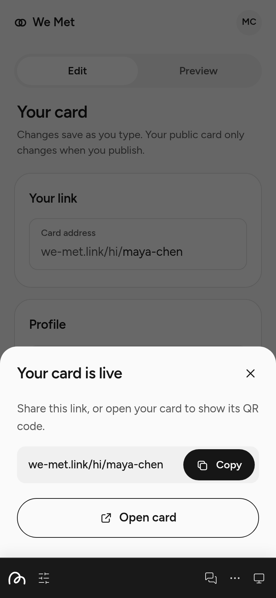 |  | 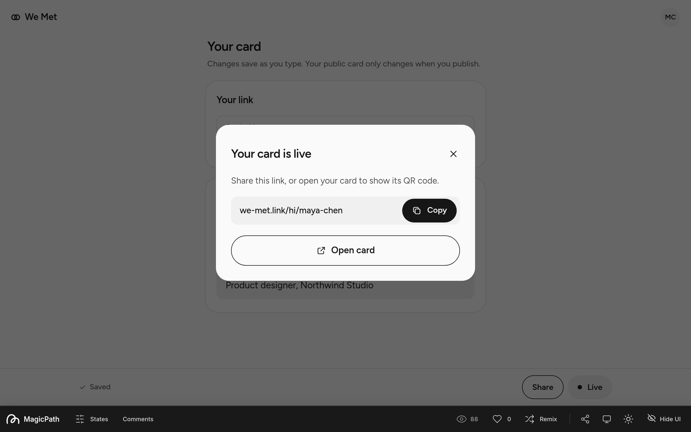 | 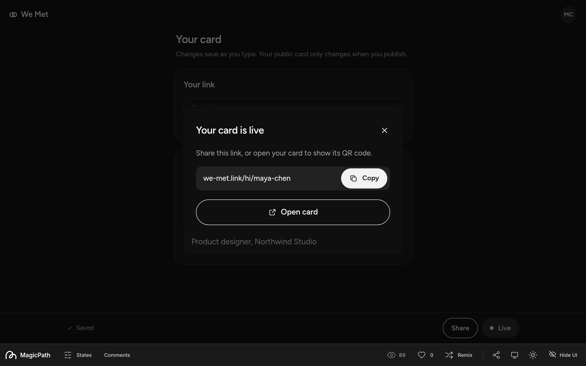 |

### Default

| Mobile light | Mobile dark | Desktop light | Desktop dark |
| --- | --- | --- | --- |
| 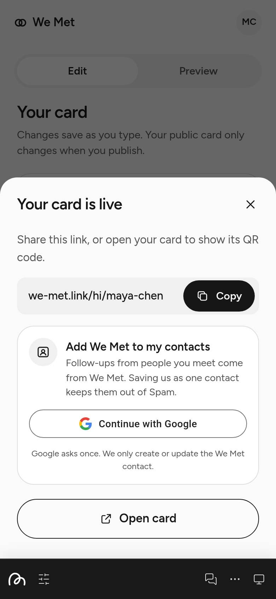 | 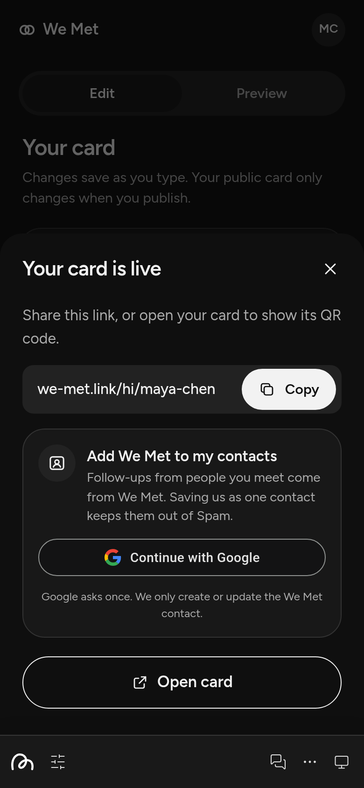 | 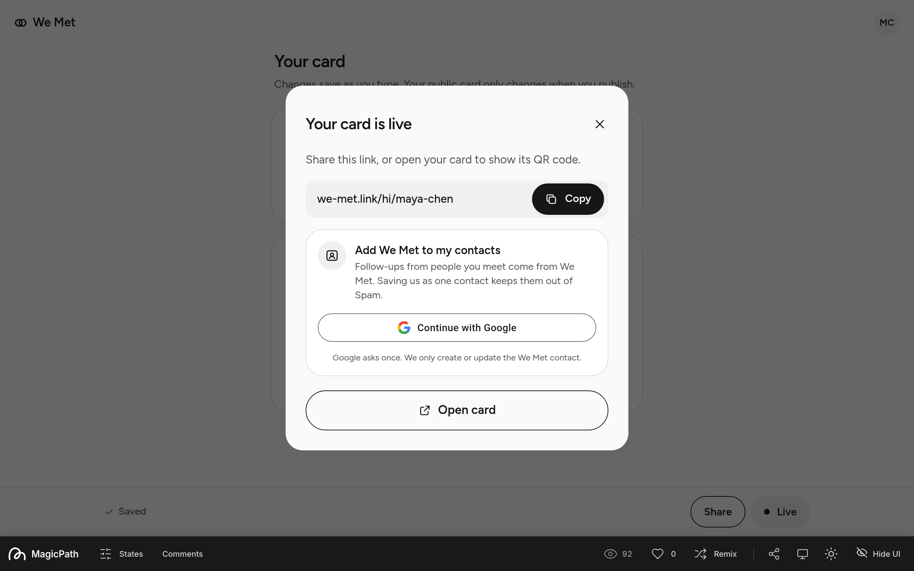 | 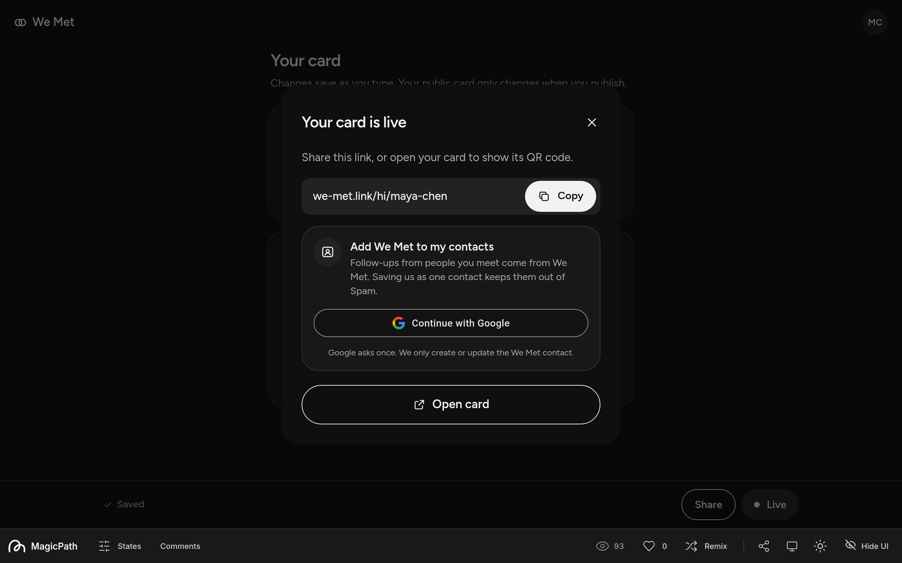 |

### Working

| Mobile light | Mobile dark | Desktop light | Desktop dark |
| --- | --- | --- | --- |
| 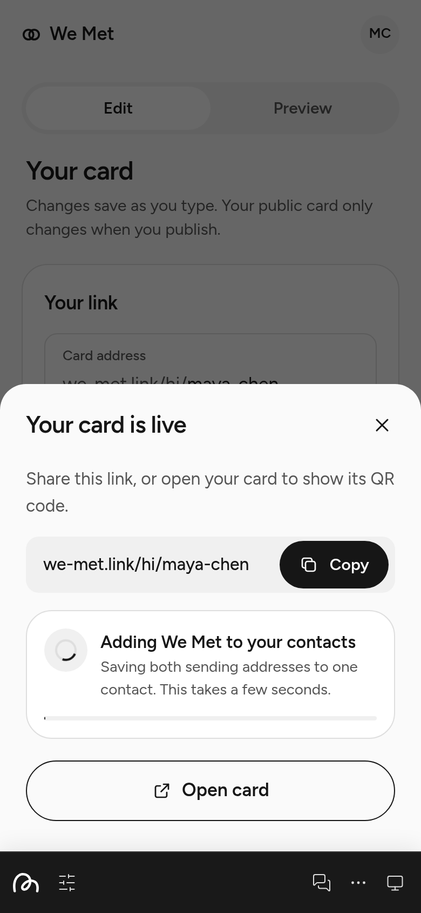 | (see desktop dark) | 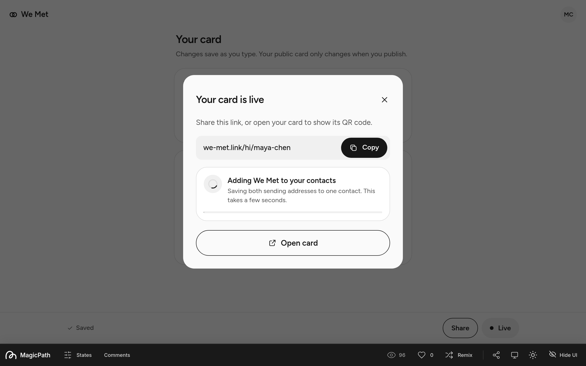 | 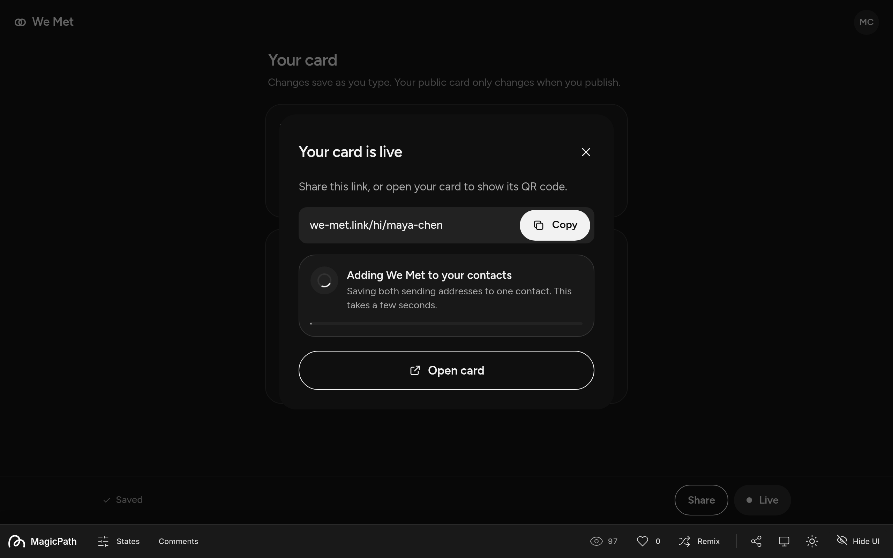 |

Note: Working mobile dark uses the same visual language as light; capture set includes desktop variants.

### Success

| Mobile light | Mobile dark | Desktop light | Desktop dark |
| --- | --- | --- | --- |
| 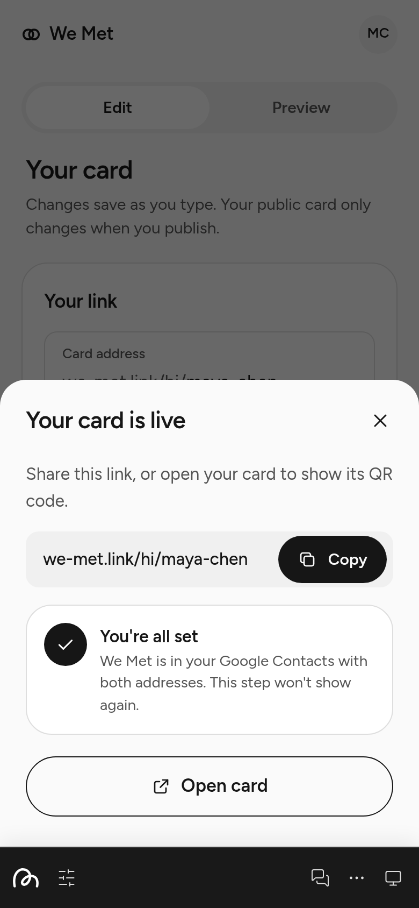 | 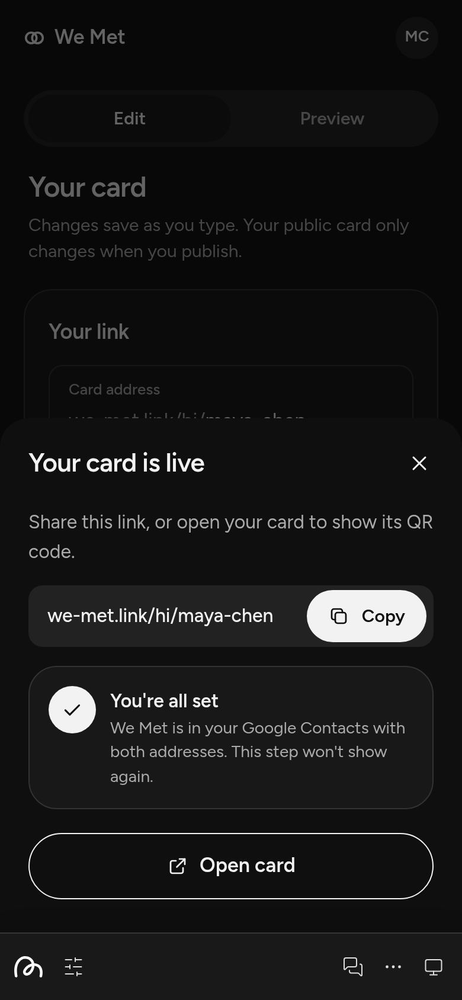 | 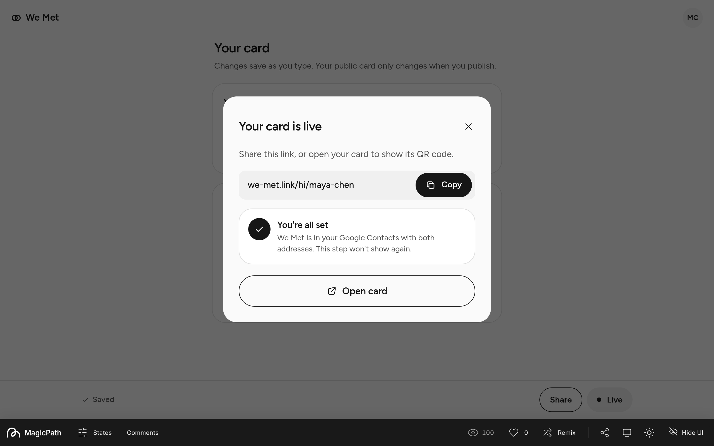 | 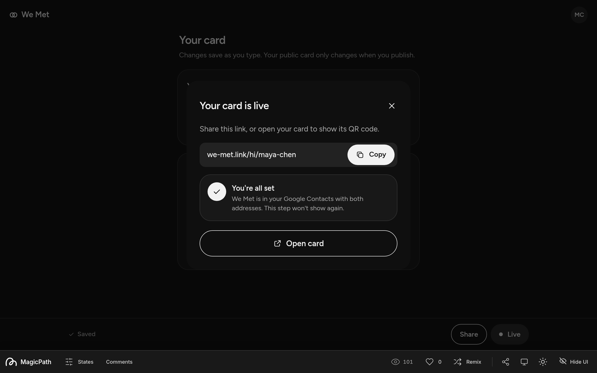 |

### Next open

| Mobile light | Mobile dark | Desktop light | Desktop dark |
| --- | --- | --- | --- |
|  | 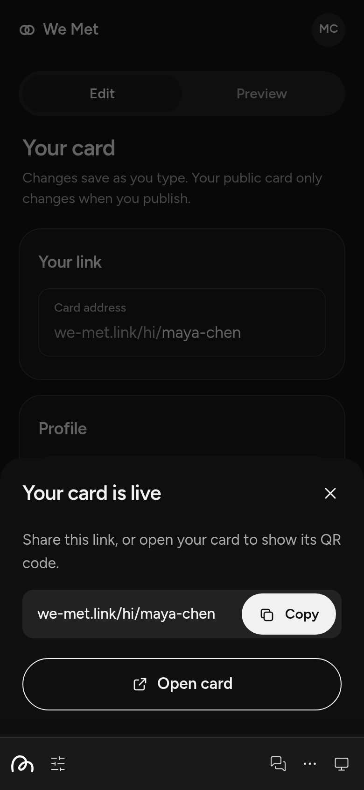 |  |  |

### Reappear

| Mobile light | Mobile dark | Desktop light | Desktop dark |
| --- | --- | --- | --- |
| 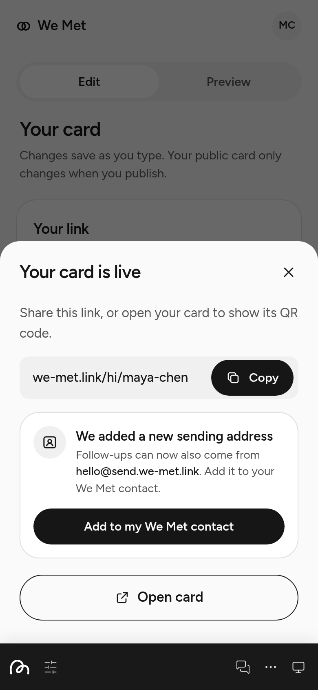 | 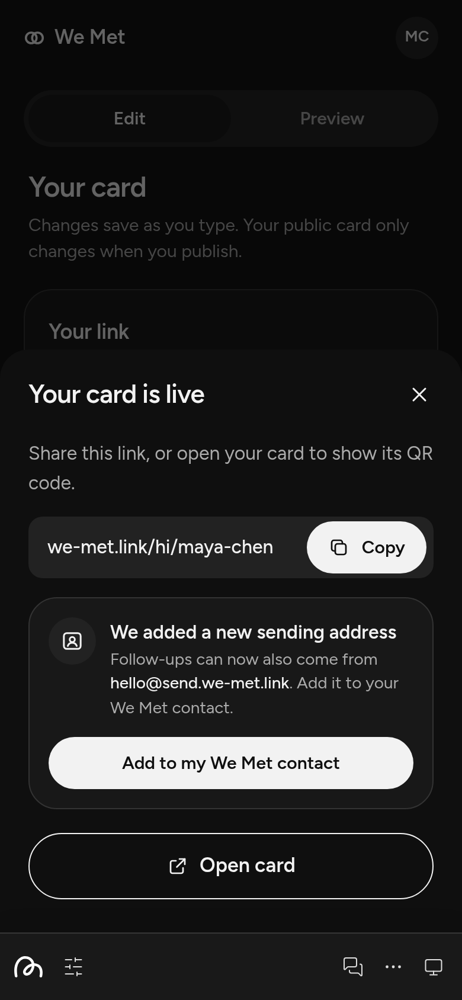 | 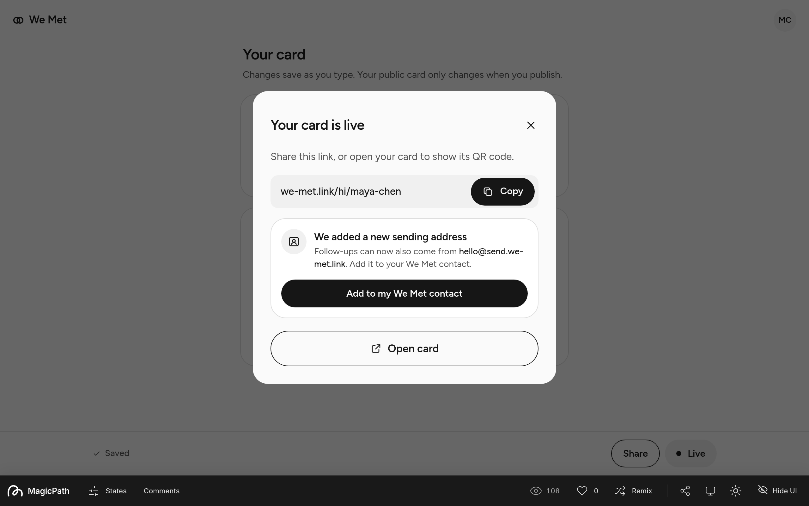 | 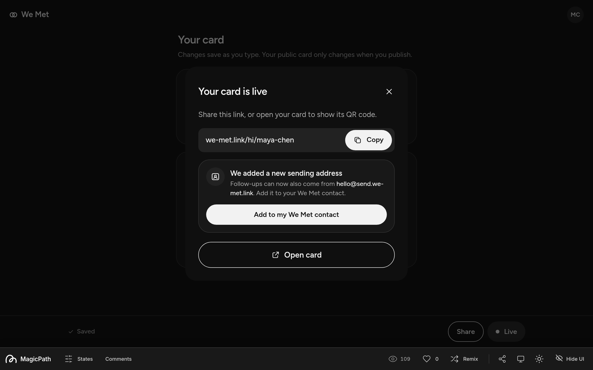 |

## Reference exports

Static MagicPath exports live in `reference/` with a `.txt` suffix so they are not picked up by TypeScript, ESLint, or Prettier:

- `contacts-setup.tsx.txt`
- `wrapper.tsx.txt`
- `kit.tsx.txt`
- `wm.css.txt`
- `App.tsx.txt`
- `index.css.txt`

Do not import these into the app build.

## Changes

- 2026-10-22: Initial spec, one-time Google contacts consent, no manual fallback ([DIDI-744](https://linear.app/didi-build/issue/DIDI-744)). Built in DIDI-747.
