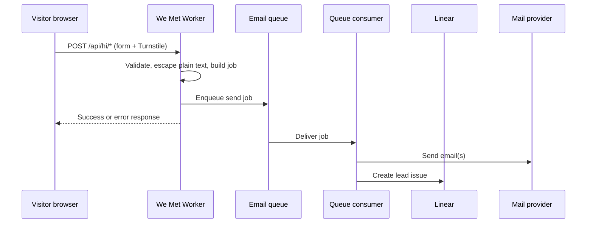

# Architecture overview — We Met

## Purpose

**We Met** hosts digital exchange-contact cards: a visitor opens a card URL, shares their details, and both sides get email with the exchange. Step 1 is a single hosted card, behavior-identical to `didi.build/hi`, with clear seams so multi-user cards can follow without rewriting the core.

## Boundaries

**This repo owns**

- The Next.js app (UI, `/api/hi/*` handlers, card rendering).
- Cloudflare Workers deployment (OpenNext), `we-met-*` queues, consumers, and env-specific bindings.
- Card presentation, theming tokens, and the contact-exchange pipeline through to email and Linear.

**Out of scope**

- The `didi-build/web` monolith at runtime (no imports or live API calls into `web`).
- General company site, marketing CMS, or unrelated Didi Build products.
- Account billing, custom DNS, and multi-tenant admin (backlog; see [open questions](#open-questions)).

## Four seams

Agents should extend behavior only through these interfaces—not ad hoc fetches or hardcoded hosts.

| Seam             | Responsibility                                                                             | Shape                                                                                                                                          |
| ---------------- | ------------------------------------------------------------------------------------------ | ---------------------------------------------------------------------------------------------------------------------------------------------- |
| **Card data**    | Load the card record for the current request (contact fields, variant, footer link, slug). | Async function or adapter: input is lookup context; output is a typed card object. Step 1 uses a static in-repo record; later, storage-backed. |
| **Email sender** | Send the fixed-template exchange emails (visitor ↔ card owner).                            | Adapter that accepts rendered plain-text bodies and metadata; production uses the bound queue + consumer; local may noop or log.               |
| **Base URL**     | One canonical origin for absolute links in email and metadata (`https://…`, no path).      | Single config value per environment (see [environments](./environments.md)); never scatter hostnames in code.                                  |
| **Lookup**       | Resolve which card serves a request.                                                       | Order: **hostname** (custom domain later) → **path** (`/p/<slug>`) → **card record**. Returns a card id/slug or not found.                     |

## Routes

| Route       | Role                                                                                                                                                                                         |
| ----------- | -------------------------------------------------------------------------------------------------------------------------------------------------------------------------------------------- |
| `/p/<slug>` | Public card page (default on `we-met.link`).                                                                                                                                                 |
| `/api/hi/*` | Exchange-contact API (submit, validation, enqueue). **Step 1 keeps these path names** so behavior matches the existing `/hi` card; see [0005](../decisions/0005-keep-api-hi-route-names.md). |

Legacy `/hi` on `didi.build` is redirected after cutover; that redirect lives outside this repo.

## Theming

- **Variants:** closed set `green` and `mono`, chosen per card in card data.
- **Colors:** only in theme token files (CSS variables / token modules). Components reference tokens, not raw hex or RGB.
- **Per-card copy:** footer link and similar fields live on the card record, not in shared layout code.

## Pipeline flow

**Failure handling**

- **Validation / Turnstile failure:** 4xx to the browser; nothing enqueued.
- **Enqueue failure:** 5xx to the browser; no email and no Linear issue (client may retry).
- **Consumer / provider failure:** message retries per queue policy; dead-letter or alert is configured on the `we-met-*` queue (operational detail in runbooks). Partial success (email sent, Linear failed) is logged; operators reconcile via [test leads](../runbooks/test-leads.md) patterns.

Non-production environments never deliver mail to real inboxes; see [0006](../decisions/0006-non-prod-safety.md) and [environments](./environments.md).

## Environments

See [environments.md](./environments.md) for queues, secrets names, previews, and deploy guards.

## Open questions

- **Multi-user:** accounts, per-user cards, storage, and abuse limits ([DIDI-581](https://linear.app/didi-build/issue/DIDI-581)).
- **Custom domains:** `card.theirdomain.com` flow and DNS ([DIDI-580](https://linear.app/didi-build/issue/DIDI-580)).
- **Pricing and packaging** ([DIDI-579](https://linear.app/didi-build/issue/DIDI-579)).
- **Exact cutover** from `didi.build/hi` to `we-met.link` (redirect timing and comms)—tracked under step 1 parent [DIDI-564](https://linear.app/didi-build/issue/DIDI-564), not finalized in this doc.
